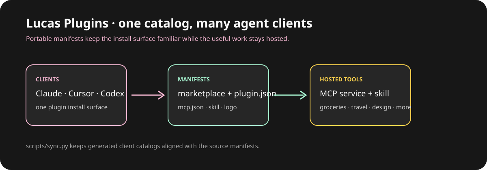

# Lucas Plugins

## Give your coding agent a better weekend.

[](https://github.com/aranlucas/lucas-plugins/actions/workflows/validate.yml)
[](LICENSE)

Lucas Plugins is a portable Agent Plugins v1 marketplace for the tools and skills I use from Claude Code, Cursor, Codex, and other compatible clients. Install the grocery plugin before meal planning, the workset plugin after the gym, or Shipshape when a repository needs a release-readiness pass. Five remote MCP connections arrive with client-specific manifests. T3 coding workflows live in the separate [t3-pstack repository](https://github.com/chhoumann/t3-pstack).



_A source-level map of clients, manifests, hosted MCP services, and optional skills._

## Available plugins

| Plugin | Purpose | Hosted connection | Skill |
| --- | --- | --- | --- |
| [`groceries`](plugins/groceries) | Kroger/QFC product search, carts, lists, pantry, deals, and meal-planning context. | `ai-meal-planner-mcp.aranlucas.workers.dev/mcp` | `shopping-assistant` |
| [`workset`](plugins/workset) | Workout planning, set-by-set logging, and training progress context. | `opengym2.up.railway.app/mcp` | `workset-coach` |
| [`shipshape`](plugins/shipshape) | Read-only GitHub portfolio readiness, branch risk, delivery hygiene, security posture, and ranked action plans. | `shipshape-mcp.aranlucas.workers.dev/mcp` | `shipshape-maintainer` |
| [`travel`](plugins/travel) | Flight, hotel, ground transport, rental car, destination, and trip planning. | `trvl-production.up.railway.app/mcp` | `travel-planner` |
| [`system-design-companion`](plugins/system-design-companion) | Shared Excalidraw system-design diagrams and architecture review. | `system-design-companion.aranlucas.workers.dev/mcp` | `system-design-companion` |

The remote endpoints are configured in each plugin’s `mcp.json`; no local server is started by this repository. The individual plugin READMEs document OAuth or other service-specific behavior.

## Install

### Claude Code

Add this repository as a marketplace, then install one or more plugins:

```text
/plugin marketplace add aranlucas/lucas-plugins
/plugin install groceries@lucas-plugins
```

Replace `groceries` with `workset`, `shipshape`, `travel`, or `system-design-companion`. Plugins that use OAuth prompt for sign-in when their service requires it.

### Cursor

Open **Settings → Plugins → Add Marketplace → Import from Repo**, enter `aranlucas/lucas-plugins`, and enable the plugins you need.

### Other Agent Plugins clients

Point the client at an individual directory such as `plugins/travel`. Each directory contains a portable `plugin.json`, optional `mcp.json`, skills, and logo. The Codex manifest for System Design Companion is kept in that plugin’s `.codex-plugin/` directory.

### T3 Code: t3-pstack

Use [t3-pstack](https://github.com/chhoumann/t3-pstack) for poteto-mode
workflows, multi-model panels, orchestration, and verification inside T3 Code.
It is maintained in its own repository and replaces the bundled Lucas Mode
skills previously in this marketplace. Install it from its own marketplace:

```bash
# Claude Code provider
claude plugin marketplace add chhoumann/t3-pstack
claude plugin install t3-pstack@t3-pstack

# Codex provider
codex plugin marketplace add chhoumann/t3-pstack
codex plugin add t3-pstack@t3-pstack
```

Then run `/t3-pstack:setup-pstack` in a T3 thread on each machine to configure
its model roles. Disable or uninstall the old `lucas-mode@lucas-plugins`
installation if you have it enabled. t3-pstack requires T3 Code; see its
[README](https://github.com/chhoumann/t3-pstack#install) for current setup guidance.

## Repository structure and generated files

The source of truth is:

- `marketplace.json` for the catalog and versions.
- `plugins/*/plugin.json` for portable plugin metadata.
- `plugins/*/mcp.json` for portable MCP server definitions.
- Optional `plugins/*/cursor.json` for Cursor presentation metadata. Set
  `displayName` to a non-empty string; without this file the plugin name is used.
- `plugins/*/skills/*/SKILL.md` and `plugins/*/assets/` for skills and logos.

`scripts/sync.py` generates the Claude and Cursor marketplace catalogs, client manifests, and Claude `.mcp.json` mirrors. Do not hand-edit those generated fields. Generated files can be deleted and recreated without losing custom display names.

## Development and validation

```bash
python3 scripts/sync.py
python3 scripts/sync.py --check
python3 -m unittest discover --start-directory tests --pattern 'test_*.py'
```

The validation workflow checks manifest paths, versions, schemas, MCP URLs, skill front matter, logos, and generated-file parity. The marketplace metadata is currently version `0.7.0`; plugin versions are recorded in `marketplace.json`.
